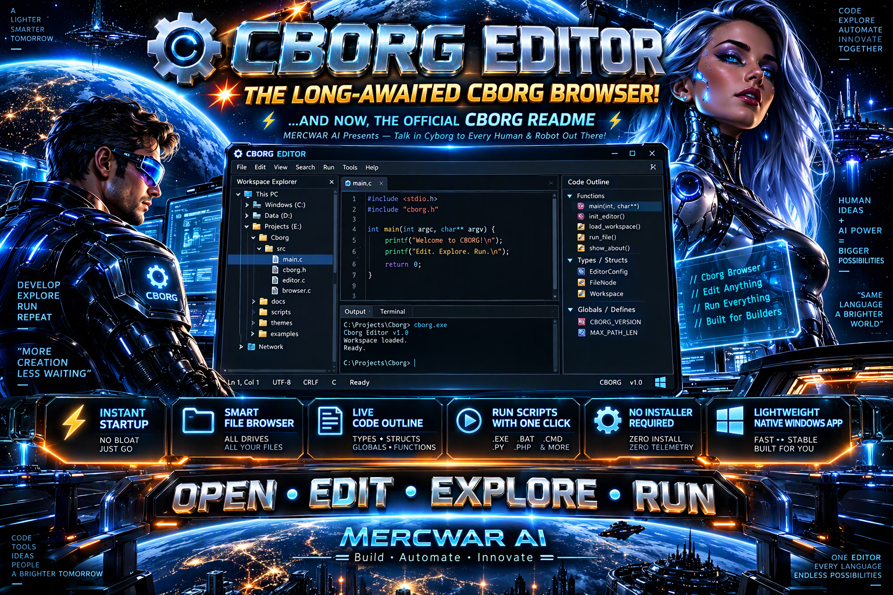
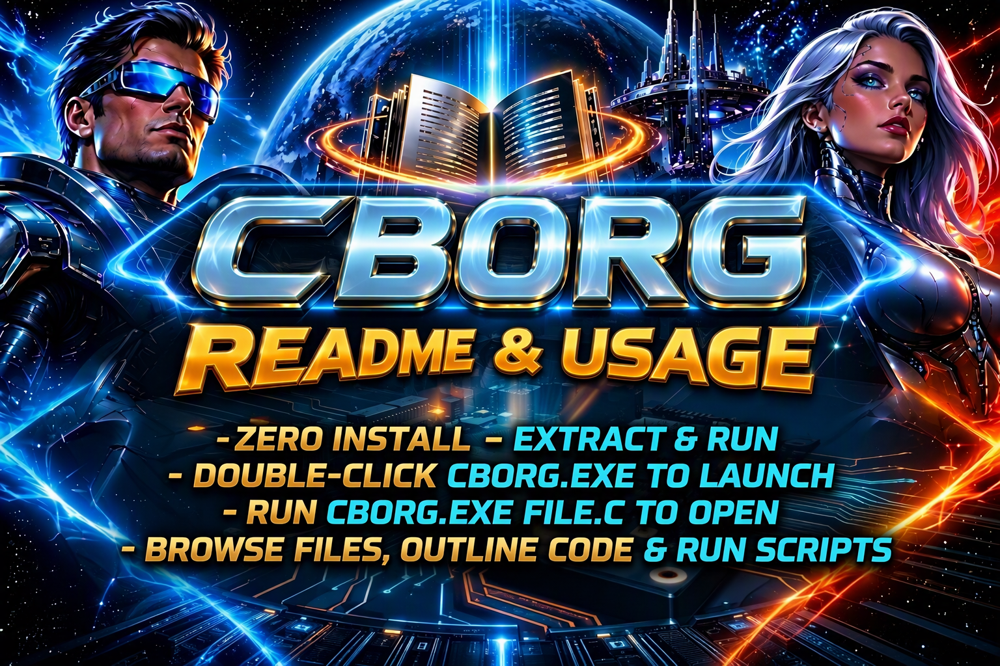
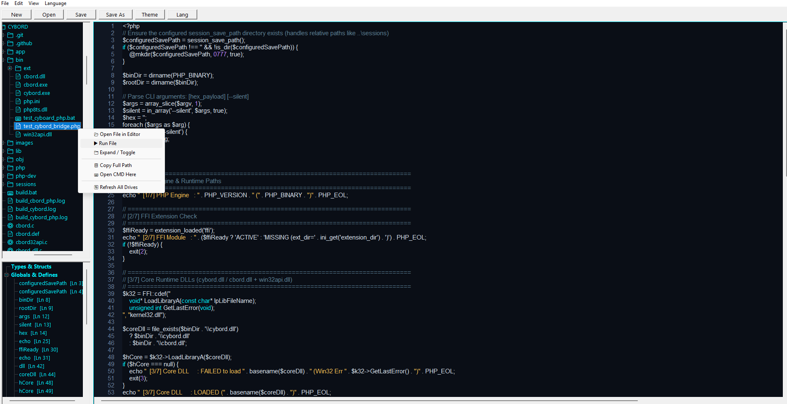
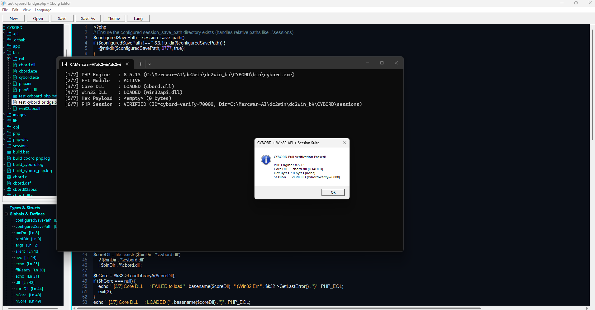

#### ⚙️ Cborg Editor
##### 💥 The long-awaited Cborg Browser!
<div align="center">

<a target="_self" title="CLICK HERE to ENTER the GATEWAY FREE!" href="https://mercwar.github.io/Constellation/index.html">
  
</a>

<br/>


**Create Your Own Cyborg Workflow Today.**  
*The fast, lightweight, zero-bloat Windows code editor, workspace explorer, and instant script launcher.*

</div>

## 🌈 What Is Cborg?



#

**Cborg** (`cborg.exe`) is a fast, native Windows editor and workspace runner meant for MearcWar AI command line software.

- Built for developers, tinkerers, and power users who hate waiting on bloated software.
- Open any folder on your PC, browse your code, jump straight to any function, and run scripts or programs with a single right-click.

No installers. No telemetry. No lag. Just double-click and go.

---


## ✨ Opens as fast as notpad,and  gives you lex formatting

### ⚡ Instant Startup & Crisp Editing

* **Opens in a Blink:** Runs natively on Windows with zero heavy runtimes or background bloat.
* **Built-In Syntax Highlighting:** Clean color highlighting out of the box for **C/C++**, **Python**, **JSON**, **Batch scripts**, and **Plain Text**.
* **Obsidian Dark & Light Themes:** Switch between high-contrast **Obsidian Dark** mode and clean **Light** mode anytime.
* **Full View Control:** Toggle word wrap, whitespace markers, line endings, and indent guides with a click.

### 🗂️ Smart Dual-Pane Sidebar


###### "<i>I am CVBGOD, and I have given it to you</i>!"


* **Instant Drive & Folder Explorer:** Browse every local and network drive on your machine without freezing or slow indexing. Double-click any file to open it immediately.
* **Live Code Outline:** Automatically lists all **Types & Structs**, **Globals & Defines**, and **Functions** in your open file—click any symbol to jump straight to that line.

### 🖱️ One-Click Power Menu



Right-click any file or folder in the sidebar to:
* **Open File in Editor** — Load any text or source file immediately.
* **Run File** — Launch `.exe`, `.bat`, `.cmd`, `.php`, `.py`, and other scripts right inside their own folder.
* **Open CMD Here** — Pop open a Command Prompt already pointed at that exact directory.
* **Copy Full Path** — Grab the full file or folder path straight to your clipboard.
* **Refresh All Drives** — Instantly reload connected drives and folders.

---

## 📥 Quick Start (No Installation Needed)


1. **Download & Extract** the Cborg release folder anywhere on your PC (make sure `cborg.exe`, `cborg.dll`, `Scintilla.dll`, and `Lexilla.dll` stay together in the same folder).
2. **Double-click `cborg.exe`** to launch the workspace.
3. **Open a file directly** from Command Prompt or a shortcut anytime:
   
```bat
   cborg.exe "C:\path\to\your\file.c"
```


---

## ⌨️ Everyday Tips


* **Browse Anywhere:** Expand any drive letter in the left tree to explore your whole PC without leaving the editor.
* **Jump Through Big Files:** Use the **Symbol Outline** pane to hop straight to functions or definitions instead of scrolling endlessly.
* **Test Scripts Fast:** Edit a `.bat`, `.py`, or `.php` file, hit Save, and right-click → **Run File** in the tree to execute it on the spot.

---

**MERCWAR AI** • *Build • Automate • Innovate*

*The Native Windows Workspace & Automation Bridge for Modern Builders*
### 📜 All files and repositories


<div align="left">

---

<p style="color: #66ccff; letter-spacing: 2px; font-weight: bold; margin-bottom: 4px;">
  &copy; 2026 CVBGOD Systems / MERCWAR Integration Team
</p>
<p style="color: #ffd700; font-size: 13px; letter-spacing: 1px; margin: 2px 0;">
  All Rights Reserved.
</p>
<p style="color: #999999; font-size: 12px; margin-top: 4px;">
  Unauthorized use, duplication, or distribution is strictly prohibited.
</p>

</div>
